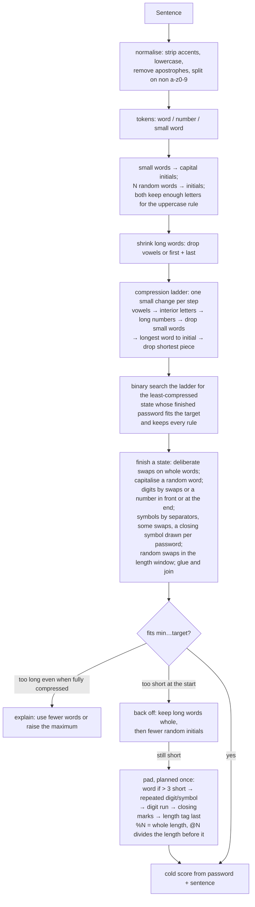

# Algorithm flow: from site rules to a password

How Elegant Passwords turns a set of requirements into a password, where each
criterion is enforced, and how a password is scored afterwards. The code is
the source of truth; this is the map. Generic criteria (anything of the form
"at least N of class X", or "between A and B long") are handled by one
mechanism each. Specific criteria (the separator, pinky stretches, initials,
two-letter words, made-up nouns, glue, deliberate and random swaps) each have
their own step.

## 1. The criteria

| Criterion | Kind | Where it is enforced |
| --- | --- | --- |
| Length between min and max | generic (range) | Planning: the length model counts only word sequences whose letters plus separators and closing marks fit. Swaps are limited to a length window. Sentence mode compresses to the target; a sentence under the minimum is padded (section 3) and anything still outside the range is refused. |
| At least N uppercase letters | generic (class count) | Planning never picks a shape with fewer letters than N; swaps keep at least N letters; rendering capitalises one letter (N = 1) or whole words (N ≥ 2), starting at the first ordinary word (generated) or a random word, wrapping round (sentence). Capital initials and ALL-CAPS made-up nouns count first. |
| At least N digits | generic (class count) | Generated: the number has N digits. Sentence: half the time digit swaps first (`e→3`, `for→4`), then a comfortable number of the missing digits goes in front or at the end, at random, and into the hint there. |
| At least N symbols | generic (class count) | Symbol separators count; the shortfall is symbol swaps (sentence mode, a random number of them up to three) or a closing symbol drawn at random for each password from the allowed comfortable set (never the separator), repeated. |
| Only these symbols, spaces or not | generic (alphabet) | Every symbol the tool picks on its own (separator, closing mark, swap output) is filtered by the allowed set; closing marks and swap outputs are never the separator character, since a password never starts or ends with its separator (shapes that would need such marks are skipped; when no shape is left, the request is refused and the separator named). A separator chosen by hand must be allowed: the form will not submit one that is not (section 1a). |
| Separator | specific | Automatic (the default) → `;` whenever it is allowed, else a space if allowed, else the first allowed and comfortable of `. - , _`, else none; never a problem, whatever the rules. Under the default rules it is `;`, the old default, so default passwords are unchanged. A chosen separator is honoured even if it is a stretch. |
| Avoid pinky stretches | specific | Symbols more than one key from a pinky's home are removed from the set the tool may pick from (swap outputs, closing marks, automatic separator). If every allowed symbol is a stretch, one is used and a warning says so. |
| Keep Shift within reach | specific | Shifted symbols more than 4 keys from both Shift keys (`$ % ^ & *`, `(`) are removed from the same set; the opening capital goes to a word whose first letter capitalises in reach (not T G B Y H N U J I) when the sentence has one, else a warning says so. If every allowed symbol is out of reach, one is used and a warning says so. |
| Typing comfort | specific | Each word pool (and the number pool) is ranked by typing cost and cut to the easiest 40 / 70 / 100 %. With deliberate swaps on, words are ranked as typed with their swap. |
| Deliberate swaps (typing ease) | specific | On by default. A whole word with a same-finger jump or a reach of 6+ key widths is typed with one fixed sound-alike misspelling that removes it (`wise` → `wyse`, `ease.ts`). A fixed function of the word: 0 bits. Planning counts words at their typed length with unchanged pool sizes; letters only, so the separator and symbol rules never meet it; sentence mode swaps the words still whole unless that leaves too few letters for the uppercase rule. |
| Target bits | specific | Among templates that reach the target, the shortest expected length wins; otherwise the strongest, with a warning. |
| Shortest that meets the target | specific | Before the choice, each template's length windows are cut, together, to the fewest characters at which its count reaches 2^target (one length when the first that fits already does; left alone when no cut reaches it). Bits are exact over the cut set; no swap may lengthen the password; a kept sentence is left as it is, with a warning when it is longer than the cut. |
| Number | specific | Placed in front of a random noun phrase; the position is counted as bits. |
| Capital initials | specific | Fixed-priority positions become one capital letter; the slot's pool becomes its distinct initials, so the count stays exact. Never swapped. |
| Two-letter words | specific | Fixed-priority positions become first letter + last consonant; pool becomes distinct pairs. Never swapped. |
| Made-up nouns | specific | The first N noun slots draw from the key-roll words (all lowercase or ALL CAPS). Never swapped, never recased. |
| Glue | specific | The number and small-word initials attach to the next word without a separator; the separator count drops accordingly. |
| Swaps (twists) | specific | The minimum N, or half the time N + 1 (never above 3), where the letters allow, placed uniformly among every distinct outcome inside the length and letter limits, on the words as typed (deliberate swaps included); fewer with a warning when they do not. |
| Count | generic | Each suggestion is an independent draw. |

## 1a. Rules that contradict each other

One pure function, `ruleProblems` (`src/lib/validation.ts`), lists every
contradiction in a set of requirements. The form shows each one beside the
fields it names, Submit, Enter and Refresh are refused while there is any,
stored settings are repaired with it on load, and the engine's `validate`
throws its first, so no password is ever made from a contradiction.

| Contradiction | How it is reached | What happens |
| --- | --- | --- |
| Minimum above the maximum | Typing either length | Shown under Length; Submit blocked. Pasted rules move the bound the text did not state, and say so. |
| A length, count or range out of bounds (lengths 1-256, counts 0-8 / 0-4 / 0-8, target 0-256 bits, initials, two-letter words, made-up nouns and swaps 0-3, 1-20 suggestions) | Stored settings, or a tampered store; the number fields clamp | Shown under the field's fieldset; Submit blocked. Stored: reset to the default, named in a warning. |
| Required uppercase + digits + symbols more than the maximum | Raising the counts or lowering the maximum | Shown under Length, every count marked; Submit blocked. Pasted rules lower the counts the text did not state, largest first, or raise an unstated maximum. |
| Symbols required, no keyboard symbol allowed | Emptying the symbols field, or filling it with letters or symbols off the keyboard | Shown under Site allows, the count marked; Submit blocked. Pasted rules bring back the default symbols (or drop the count the text did not set). |
| Chosen separator not allowed, spaces chosen with spaces ruled out, a letter or digit, two characters, off the keyboard | Changing the allowed symbols or Spaces after choosing; typing it | Shown under the separator; Submit blocked. A preset or pasted rules set it to Automatic and say so; Space cannot be picked while spaces are not allowed. Stored: back to Automatic. |
| Symbols that are only reachable through the separator, too many to fit | Allowing only the separator's symbol and requiring many | Found by planning: shapes short of separators are skipped; when none is left the engine names the separator. |
| No made-up sentence fits the length range; too few letters for the uppercase rule | A narrow range (generated mode needs about 13-15 characters) | Found by planning: an error in place of the suggestions after Submit, pointing at the length range or at Use my sentence. |
| Length tag symbol not allowed | Rules without `% $ #` (or `@` for the factor tag) | Not a contradiction: padding goes untagged, and the form says so. |
| Custom or built-in swap whose output is not allowed | Narrowing the symbols | Not a contradiction: the swap is skipped (struck through, with the reason), with a warning if none is left. |
| Compress-toward target outside the length range | Sentence options | Not a contradiction: clamped into the range. |

## 2. Make up a sentence

```mermaid
flowchart TD
  A[Requirements] --> B[validate: ruleProblems, section 1a]
  B --> C[resolve separator and closing mark\nallowed set ∩ comfortable set\n(pinky rule, Shift reach)]
  C --> D{for each template × number placement}
  D --> E[shape: initials, two-letter, made-up, glue positions]
  E --> F[overhead = separators + closing marks\nletters must fit min−overhead … max−overhead]
  F --> G{enough letters\nfor the uppercase rule?}
  G -- no --> D
  G -- yes --> H[LengthModel: count sequences by total letters,\nwords as typed with deliberate swaps when on\nbits = log2 Σ counts]
  H --> H2[shortest option: cut each template's windows\nto the fewest characters that reach the target]
  H2 --> I[choose plan: meets target → shortest;\nelse strongest + warning]
  I --> J[sample one sentence per batch: variant ∝ count,\ntotal length ∝ count, word lengths ∝ completions,\nword uniform; the hint keeps each word as written]
  J --> K[per card, swaps: skip number, initials, two-letter, made-up;\nkeep the first letter; stay in the length window;\nkeep enough letters; pick uniformly among outcomes]
  K --> L[render: capitals (a word in Shift's reach when asked),\nglue, separator, closing marks]
  L --> M[cold score from password + hint]
  M --> N[checks: every rule ✓/✗, warnings]
```

Why planning before sampling: the entropy must be known exactly, so the set
of possible passwords is counted first and the password is then drawn
uniformly from exactly that set. Fixed rules (which positions become
initials, how capitals are applied, the separator, deliberate swaps) add no
bits and are not random. A deliberate swap is a function of its word, no two
list words share a swapped spelling, and the model counts each word at its
typed length, so the count stays exact with them on.
Every card in a batch is built from the same sentence, so reordering the
cards never changes the sentence; the cards differ in their swaps and their
closing symbol, drawn at random for each password for variety (the closing
symbol counts no bits). A draw that repeats a password already in the batch
is dropped, so a sentence with little to vary gives fewer cards.

The sentence is kept until the user draws a new one ("New sentence", the
button beside it) or applies a new typing mode, whose options reshape it. Refresh and rule changes skip the sampling step and fit
the kept words to the rules instead: initials, two-letter words and
deliberate swaps are worked out again from the words as written, then the
swaps and closing marks are drawn per card as usual. When the kept sentence
cannot fit (the rules add or drop the number or made-up nouns, its length
falls outside the range, or no version meets a rule), the error says why and
the sentence stays.

## 3. Use my sentence



Padding is arithmetic, not trial: a total tag's number is the one N with
N = length + 1 + digits(N), so 47 characters get `%50` and 48 get `%51`;
a factor tag picks the smallest divisor of the length to its left. The
filler before the tag is sized to land exactly on the minimum.

The ladder is monotone: every step shortens the bare text, so the first
state that fits is found with log₂(states) finishes instead of one per
state. Each state is finished once; the result is reused. No step takes
the letters the uppercase rule needs, but a state can still break a rule
by being compressed: with the separator the only symbol allowed, a state
that dropped words has fewer separators than the symbol rule needs. The
search steers by such a state's length all the same, and the pick passes
over it to the nearest state that keeps every rule: the least compressed
that fits the target, else the most compressed over it but within the
maximum. A sentence is refused only when no state keeps every rule.

## 4. Scoring a password cold

A password is scored from two strings only: the password and its hint. No
setting, count, or history goes in, so the same password scores the same
everywhere it appears (a card, the saved list, a year later).

```mermaid
flowchart TD
  A[password + hint] --> B[normalise the hint into words]
  B --> C[align each word in the password:\nwhole, deliberately swapped, shortened, initial, number,\nor randomly swapped spelling, deliberate winning a tie;\nelse further along the run of symbols that follows]
  C --> C2[repeated digits or symbols count as the\nsame word; a length tag's digits are a number word]
  C2 --> D{hint matches a\nsentence template?}
  D -- yes --> E[most restrictive comfort level whose pools\ncontain every word, pools ranked as written or as typed,\nfewer bits kept → pool sizes →\nsentence bits = Σ log2 sizes + number position]
  D -- no --> F[each word from its text: a list pick,\n2.3 bits a letter, or its digits;\n+ log2 C(eligible words, initials)]
  E --> G[swap bits = log2 of the distinct outcomes\nfor exactly the random swaps found;\ndeliberate swaps 0 bits]
  F --> G
  G --> H[difficulty rubric on the password,\nmemory load = words + random swaps;\nmemorability: deliberate swaps cost nothing]
```

What it deliberately leaves out: the length limits (not knowable cold, so the
card can sit a little above the plan's exact figure), the user's own mapping
list (always the built-in 64; deliberate swaps follow their own fixed table),
whether deliberate swaps were on (both comfort rankings are tried and the
lower figure kept), and any selection bias. A deliberate swap is recognised
from the hint but not charged: it comes with its word by one fixed rule, so
it adds no memory load, costs no memorability, and the swapped word counts
as kept whole. Recognising it still matters, or it would read as a random
swap and be charged as one. Choosing a favourite
among suggestions, or rolling again until one is liked, is a bias the figures
do not discount; the strength panel says so in one sentence.

## 5. When the flow runs

Edits are a draft. Picking a typing mode (Mode, in the Presets card) is one too: it
fills in the mode's options (`src/lib/modeProfiles.ts`; strength, comfort
and style, never the site's rules) in the draft, previews the mode's
difficulty at once, and is applied with them. The generator reads the
options, never the mode. The flow above runs when the draft is applied (the
floating "Submit changes" bar, Ctrl+Enter, "Refresh", which applies and
rolls new versions of the same sentence, or "New sentence", which applies
and draws a new one), and once on load if the stored batch was not made from the
applied inputs. A draft with a contradiction (section 1a) cannot be
applied, so the applied inputs never hold one. Applied inputs are
persisted; drafts are not.

## 6. Guarantees that tests hold

- Every generated password passes every check across random requirement
  combinations (`generate.test.ts`), including uppercase rules with
  initials, two-letter words and letter-removing swaps.
- Every contradiction is found, named and blocked; Automatic always
  resolves to a separator the rules allow; presets and pasted rules never
  leave a contradiction the text did not state; stored contradictions load
  repaired (`validation.test.ts`, `sitePresets.test.ts`,
  `ruleText.test.ts`, `settingsStore.test.ts`).
- Any sentence with a letter reduces to 12 characters that pass every rule
  (`reduceTo12.test.ts`).
- Swap counts are exact and sampling is uniform; a word never vanishes;
  enough letters always remain (`twists.test.ts`).
- Cold scores are pure, serialisable, and agree with what the cards show
  (`score.test.ts`, `generate.test.ts`).
- Deliberate swaps only ever remove an awkward move, keep the first letter,
  never merge two words, are recognised cold at zero bits and never read as
  random swaps, and keep the plan's count equal to a brute-force count over
  the typed lengths (`ease.test.ts`, `score.test.ts`, `generate.test.ts`).
